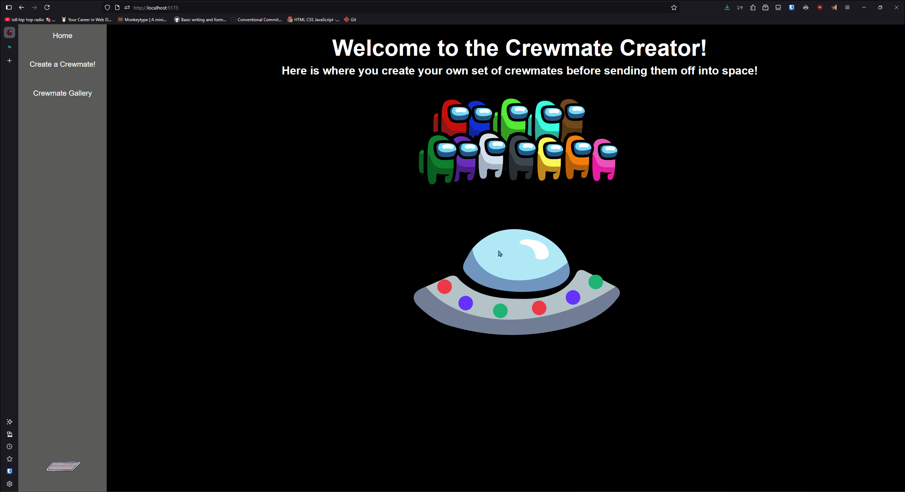

# Web Development Project 7 - _Among Us Crewmates_

Submitted by: **Sebastián L. Corporán Berríos**

This web app: **Implements CRUD operations for a database of crewmates of the popular game "Among Us". The app consists of 3 pages: The "Home" page, the "Create" page, and the "Gallery" page. The "Create" page, displays a form where the user can enter create a crewmate. Once the crewmate is created, it will be inserted as a record in the table of the database. In the "Gallery" page, the user can edit the data of the crewmate, as well as remove the crewmate.**

Time spent: **20** hours spent in total

## Required Features

The following **required** functionality is completed:

-   [x] **The web app contains a page that features a create form to add a new crewmate**
    -   Users can name the crewmate
    -   Users can set the crewmate’s attributes by clicking on one of several values
-   [x] **The web app includes a summary page of all the user’s added crewmatese**
    -   The web app contains a summary page dedicated to displaying all the crewmates the user has made so far
    -   The summary page is sorted by creation date such that the most recently created crewmates appear at the top
-   [x] **A previously created crewmate can be updated from the list of crewmates in the summary page**
    -   Each crewmate has an edit button that will take users to an update form for the relevant crewmate
    -   Users can see the current attributes of their crewmate on the update form
    -   After editing the crewmate's attribute values using the form, the user can immediately see those changes reflected in the update form and on the summary page
-   [x] **A previously created crewmate can be deleted from the crewmate list**
    -   Using the edit form detailed in the previous _crewmates can be updated_ feature, there is a button that allows users to delete that crewmate
    -   After deleting a crewmate, the crewmate should no longer be visible in the summary page
    -   [x] **Each crewmate has a direct, unique URL link to an info page about them**
        -   Clicking on a crewmate in the summary page navigates to a detail page for that crewmate
        -   The detail page contains extra information about the crewmate not included in the summary page
        -   Users can navigate to to the edit form from the detail page

The following **optional** features are implemented:

-   [ ] A crewmate can be given a category upon creation which restricts their attribute value options
    -   e.g., a Dungeons and Dragons class or a development team role (project manager, product owner, etc.)
    -   User can choose a `category` option to describe their crewmate before any attributes are specified
    -   Based on the category value, users are allowed to access only a subset of the possible attributes
-   [ ] A section of the summary page, displays summary statistics about a user’s crew on their crew page
    -   e.g., the percent of members with a certain attribute
-   [ ] The summary page displays a custom “success” metric about a user’s crew which changes the look of the crewmate list
    -   e.g., a pirate crew’s predicted success at commandeering a new galley

The following **additional** features are implemented:

-   [x] The form that creates a crewmate prevents the user from entering a speed value that is less than or equal to zero.

-   [x] The data of the form was validated using exception handling

-   [x] The border of the card that displays the information of the crewmate,
        has a color that the "color" attribute.

-   [x] Re-direct the user to the "Gallery" page when a record is removed.

## Video Walkthrough

Here's a walkthrough of implemented user stories:

<!-- Replace this with whatever GIF tool you used! -->

GIF created with [ScreenToGif](https://www.screentogif.com/) for Windows

<!-- Recommended tools:
[Kap](https://getkap.co/) for macOS
[peek](https://github.com/phw/peek) for Linux. -->

## Notes

Describe any challenges encountered while building the app.

-   **Styling each page**: To style each page, I used a different stylesheet. This lead to having the same names of class attributes,
    or id attributes. This led to confusion, and also, I noticed that despite not styling a specific container of a page, if a previous
    styled page had that exact same id or class attribute, the container would apply the style that was used in the other page.

-   **How to implement the CRUD operations in React**: This was the hardest challenge of the project. I did not know when it was adequate to use a useEffect, because in the lab, some CRUD operation did not use useEffect.

-   **Blank screen after removing a record**: AFter removing a record, an error was thrown with the message "[Object, Object]". To work around this, what I did was redirect the user to the "Gallery" page each time a record is removed.

## License

    Copyright [2025] [Sebastián L. Corporán Berríos]

    Licensed under the Apache License, Version 2.0 (the "License");
    you may not use this file except in compliance with the License.
    You may obtain a copy of the License at

        http://www.apache.org/licenses/LICENSE-2.0

    Unless required by applicable law or agreed to in writing, software
    distributed under the License is distributed on an "AS IS" BASIS,
    WITHOUT WARRANTIES OR CONDITIONS OF ANY KIND, either express or implied.
    See the License for the specific language governing permissions and
    limitations under the License.
